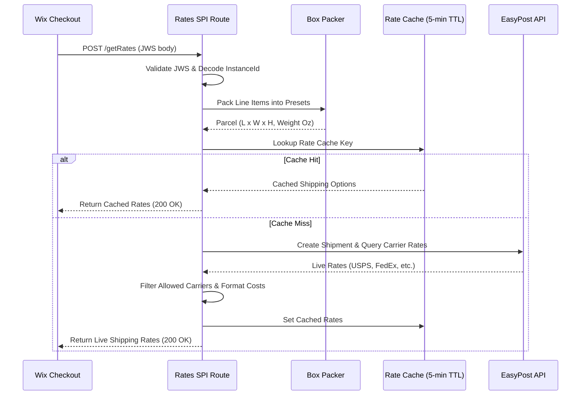

# 02. Shipping Rates SPI & Cartonization Plan

## 1. Overview

The Wix eCommerce Shipping Rates SPI (`/api/shipping-rates/v1/getRates`) is invoked synchronously during buyer checkout. It calculates live carrier rates from EasyPost based on line items, weights, and destinations.

---

## 2. Core Execution Flow

---

## 3. Key Enhancements

1. **State & Subdivision Normalization (`normalizeStateCode`)**:
   - Wix sends ISO 3166-2 subdivisions (e.g., `"US-NJ"`).
   - EasyPost and domestic US carriers require standard 2-letter uppercase codes (e.g., `"NJ"`).
   - Handled via `normalizeStateCode()` in `src/app/utils/address-helper.ts`.

2. **Carrier Prefix Matching**:
   - EasyPost returns sandbox FedEx rates under `"FedExDefault"`.
   - Rate filtering supports prefixes so that configuring `FEDEX` matches both `FEDEX` and `FedExDefault`.

3. **Cartonization & Box Packing**:
   - Normalizes items to ounces and inches.
   - Evaluates standard presets (`Small Box`, `Medium Box`, `Large Box`, `Flat Rate Envelope`).
   - Falls back to custom parcel dimensions when preset bounds are exceeded.

