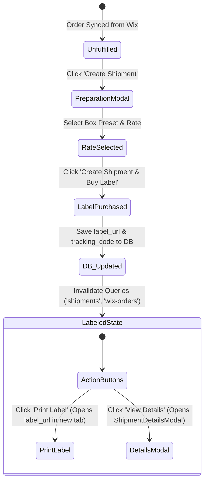

# 03. Label Generation & Orders Workflow Plan

## 1. Overview & Objectives

This document specifies the end-to-end order fulfillment and label generation workflow:
1. **Permanent Label URL Storage in Database**:
   - Store the postage label URL returned by EasyPost (`postage_label.label_url` or `label_pdf_url`) permanently in the database.
2. **Dynamic Button Replacement in Orders Tab**:
   - Replace the default **"Create Shipment"** button with **"Print Label"** and **"View Details"** once a label has been purchased.
3. **Dedicated Shipment Details Modal**:
   - Provide a full inspection view of purchased postage, tracking code, carrier rate, package dimensions, and addresses.

---

## 2. Orders Tab Action State Machine

---

## 3. Database Persistence (`label_url`)

When `buyShipmentLabelAction(shipmentId, rateId)` executes:
1. EasyPost API `Shipment.buy(shipmentId, rateId)` returns:
   - `postage_label.label_url` (S3 URL to PDF/PNG label)
   - `tracking_code`
   - `tracker.id`
   - `selected_rate`
2. `shipmentRepo.updateShipmentStatus()` persists these fields directly in PostgreSQL:
   - **PostgreSQL Database**: Updated in table `shipments` column `label_url`.

---

## 4. UI Components & Workflow

### A. Orders Table (`OrdersTab.tsx`)
- Queries both Wix orders (`useSearchOrders`) and local shipments (`useShipments`).
- Indexes shipments by `wix_order_id`.
- Action column logic:
  - If `orderShipment?.label_url` is present:
    - **"Print Label"**: Primary action button. Calls `window.open(orderShipment.label_url, '_blank')`.
    - **"View Details"**: Secondary action button. Opens `ShipmentDetailsModal`.
  - If no shipment/label exists:
    - **"Create Shipment"**: Primary action button. Opens `ShipmentPreparationModal`.

### B. Shipment Details Modal (`ShipmentDetailsModal.tsx`)
- Displays:
  - Order # and fulfillment status badge.
  - Carrier & Service (e.g., `USPS Priority Mail - $13.48`).
  - Tracking Number with copy-to-clipboard and carrier tracking link.
  - Dispatch Origin and Destination address.
  - Package weight and dimensions.
  - Quick action: "Open Postage Label (PDF/PNG)".

### C. In-Modal Fulfillment Success (`ShipmentPreparationModal.tsx`)
- When the label purchase finishes:
  - Switches to a confirmation view displaying the tracking code and a "Print Label" button.
  - Automatically invalidates `['shipments']` cache so the Orders table updates immediately.

