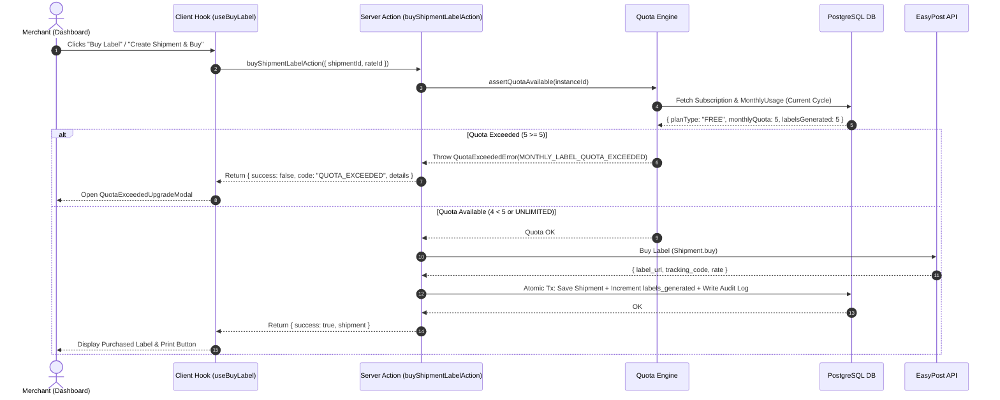

# 02. Quota Enforcement Engine

## 1. Enforcement Architecture & Flow

The quota engine enforces label limits **strictly on the backend before postage is purchased via EasyPost**. Merchants cannot bypass limits via client-side manipulation.



---

## 2. Server-Side Quota Assertion Implementation

```typescript
export interface QuotaCheckResult {
  allowed: boolean;
  planType: PlanTierType;
  monthlyQuota: number;
  labelsGenerated: number;
  remainingLabels: number; // -1 for unlimited
  resetDate: Date;
  upgradeUrl?: string;
}

export class QuotaExceededError extends Error {
  code = 'MONTHLY_LABEL_QUOTA_EXCEEDED';
  details: QuotaCheckResult;

  constructor(details: QuotaCheckResult) {
    super(
      `Monthly label limit of ${details.monthlyQuota} reached for the ${details.planType} plan. Upgrade to generate more labels.`,
    );
    this.name = 'QuotaExceededError';
    this.details = details;
  }
}

/**
 * Checks and asserts that the tenant has quota available for the current billing month.
 */
export async function assertQuotaAvailable(instanceId: string): Promise<QuotaCheckResult> {
  const currentCycleKey = getBillingCycleKey(new Date()); // e.g. "2026-11"

  // 1. Fetch or initialize subscription
  const subscription = await getOrCreateSubscription(instanceId);

  // 2. Unlimited plan has zero restrictions
  if (subscription.planType === 'UNLIMITED' || subscription.monthlyQuota === -1) {
    return {
      allowed: true,
      planType: 'UNLIMITED',
      monthlyQuota: -1,
      labelsGenerated: 0,
      remainingLabels: -1,
      resetDate: subscription.currentPeriodEnd,
    };
  }

  // 3. Fetch current monthly usage
  const usage = await getOrCreateMonthlyUsage(instanceId, currentCycleKey);

  const remaining = Math.max(0, subscription.monthlyQuota - usage.labelsGenerated);
  const result: QuotaCheckResult = {
    allowed: usage.labelsGenerated < subscription.monthlyQuota,
    planType: subscription.planType as PlanTierType,
    monthlyQuota: subscription.monthlyQuota,
    labelsGenerated: usage.labelsGenerated,
    remainingLabels: remaining,
    resetDate: subscription.currentPeriodEnd,
    upgradeUrl: getWixUpgradeCheckoutUrl(instanceId),
  };

  if (!result.allowed) {
    throw new QuotaExceededError(result);
  }

  return result;
}
```

---

## 3. Atomic Database Increment & Concurrency Safety

To prevent race conditions when a merchant generates labels concurrently across multiple tabs, the usage count is updated atomically within a PostgreSQL transaction:

```typescript
export async function recordLabelPurchaseSuccess(params: {
  instanceId: string;
  shipmentId: string;
  trackingCode?: string;
  carrier: string;
  service: string;
  rateAmount: number;
}): Promise<void> {
  const currentCycleKey = getBillingCycleKey(new Date());

  await prisma.$transaction(async (tx) => {
    // 1. Atomically increment usage
    const updatedUsage = await tx.monthlyUsage.upsert({
      where: {
        instanceId_billingCycleKey: {
          instanceId: params.instanceId,
          billingCycleKey: currentCycleKey,
        },
      },
      update: {
        labelsGenerated: { increment: 1 },
        lastLabelGeneratedAt: new Date(),
      },
      create: {
        instanceId: params.instanceId,
        billingCycleKey: currentCycleKey,
        labelsGenerated: 1,
        lastLabelGeneratedAt: new Date(),
      },
    });

    // 2. Fetch current subscription to record plan snapshot
    const sub = await tx.merchantSubscription.findUnique({
      where: { instanceId: params.instanceId },
    });

    // 3. Create immutable audit record
    await tx.subscriptionUsageLog.create({
      data: {
        instanceId: params.instanceId,
        shipmentId: params.shipmentId,
        trackingCode: params.trackingCode,
        carrier: params.carrier,
        service: params.service,
        rateAmount: params.rateAmount,
        planType: sub?.planType || 'FREE',
        quotaCountAfter: updatedUsage.labelsGenerated,
        subscriptionId: sub?.id,
      },
    });
  });
}
```

---

## 4. Zero-Maintenance Monthly Cycle Rollover

- **No Cron Jobs Required**: Because `billingCycleKey` is determined by `YYYY-MM` (or the tenant's renewal period), when a new month begins, `assertQuotaAvailable` automatically references the new key (e.g. `2026-12`).
- The count resets to `0` automatically on the 1st of each month.
- Historical usage remains preserved in PostgreSQL for historical billing analytics and merchant transparency.
