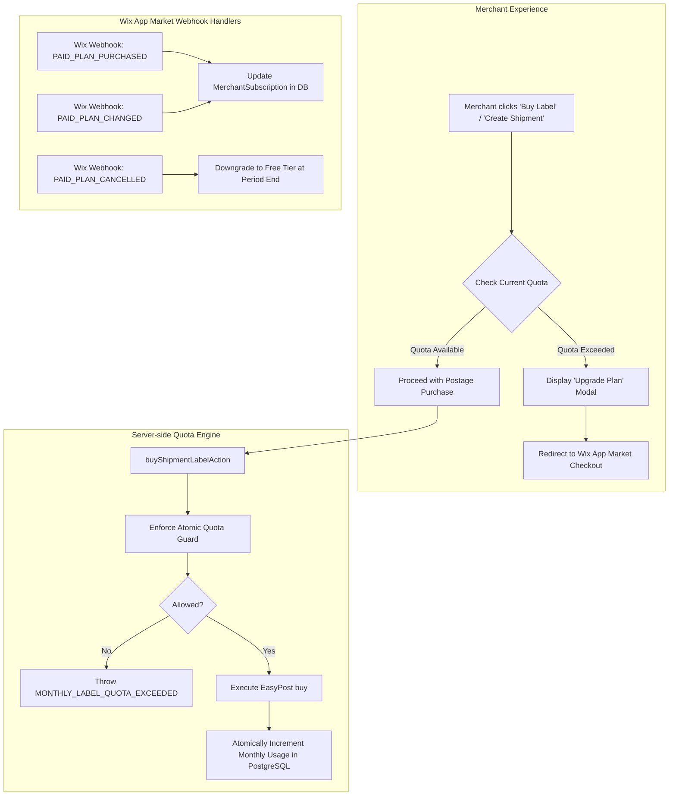

# Wix App Market Subscription & Tiered Billing Engine

## 1. Overview & Business Objectives

This subsystem introduces a native subscription and label quota monetization engine for the **EasyPost x Wix Shipping App**.

Monetization is managed directly via the **Wix App Market Paid Plans infrastructure** and enforced server-side before postage labels are generated and charged via EasyPost.

---

## 2. Subscription Plans & Quotas (Wix Developers Center Configuration)

| Plan Tier     | Product ID  | Monthly Price            | Yearly Payment Discount | Monthly Label Quota     | Over-Quota Policy                   |
| :------------ | :---------- | :----------------------- | :---------------------- | :---------------------- | :---------------------------------- |
| **Basic**     | `basic`     | **Free to Install** ($0) | -                       | **5 Labels / month**    | Hard lock with Upgrade Modal prompt |
| **Starter**   | `starter`   | **$5.00 / month**        | 20% yearly discount     | **50 Labels / month**   | Hard lock with Upgrade Modal prompt |
| **Growth**    | `growth`    | **$10.00 / month**       | 20% yearly discount     | **100 Labels / month**  | Hard lock with Upgrade Modal prompt |
| **Unlimited** | `unlimited` | **$20.00 / month**       | 10% yearly discount     | **Unlimited** (&infin;) | Never restricted                    |

- **Billing Cycle**: Automatically resets on the 1st of each calendar month at 00:00:00 UTC (or aligns with the merchant's Wix App Market subscription renewal anchor date).
- **Quota Deduction**: Counted strictly on successful postage label purchase (`LABEL_PURCHASED`). Unpurchased draft shipments and rate quotes do NOT consume quotas.

---

## 3. Architecture Blueprint

---

## 4. Documentation Index

1. [**01_SUBSCRIPTION_TIERS_AND_DATA_MODEL.md**](./01_SUBSCRIPTION_TIERS_AND_DATA_MODEL.md) — PostgreSQL Prisma schema (`merchant_subscriptions`, `monthly_usages`, `subscription_usage_logs`), models, and tenant lifecycle.
2. [**02_QUOTA_ENFORCEMENT_ENGINE.md**](./02_QUOTA_ENFORCEMENT_ENGINE.md) — Server actions, atomic concurrency locking, quota middleware, and reset routines.
3. [**03_WIX_APP_MARKET_BILLING_INTEGRATION.md**](./03_WIX_APP_MARKET_BILLING_INTEGRATION.md) — Wix Dev Center configuration, signed instance token verification (`instance.billing`), webhooks, and checkout URLs.
4. [**04_BILLING_DASHBOARD_AND_UPGRADE_UI.md**](./04_BILLING_DASHBOARD_AND_UPGRADE_UI.md) — "Billing & Plans" dashboard tab, visual usage progress bar, tier comparison cards, and the interactive Upgrade Modal.
